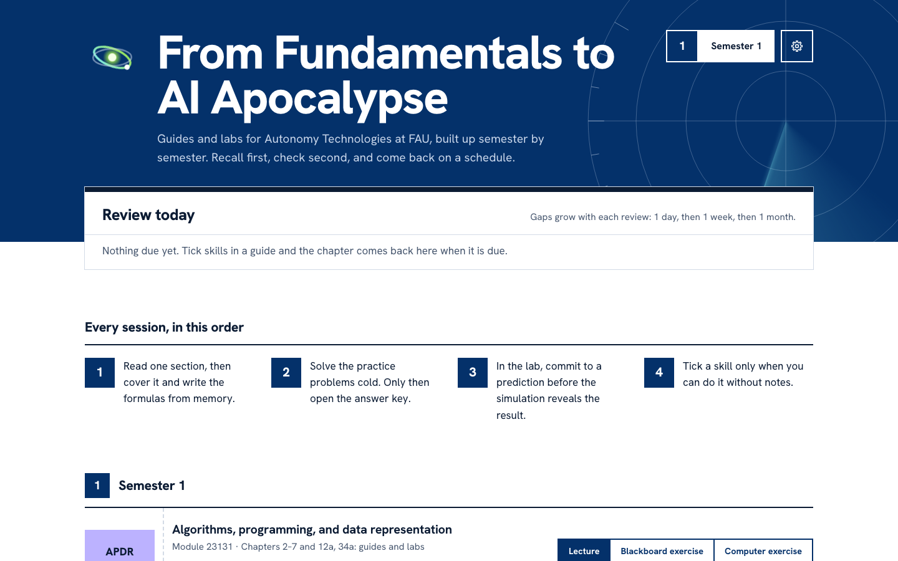

# From Fundamentals to AI Apocalypse

Study guides and interactive labs for the Autonomy Technologies programme at FAU Erlangen-Nürnberg, built up semester by semester for the whole degree.

**[Open the site →](https://unknown-x0.github.io/AutonomyTechnologies/)**



> Personal study material written from the lecture notes. Not an official FAU publication; check anything exam-relevant against your course materials.

## What's inside

The home page has one section per semester. Each subject shows its module number, its course parts and, once they exist, its chapters with a study guide and a lab, plus worked exercises, tutorials, and appendices.

| Semester | Code | Subject | Module | Course parts |
| --- | --- | --- | --- | --- |
| 1 | APDR | Algorithms, programming, and data representation | 23131 | Lecture, blackboard exercise, computer exercise |
| 1 | MEI | Mathematics for Engineers I | 27651 | Lecture, exercise |
| 1 | EEI | Electrical Engineering I | 23151 | Lecture, exercise, tutorial |
| 1 | MATLAB | Introduction to MATLAB | 23171 | Course (not started yet) |

What exists for each subject is listed on the home page; every guide also has a printable PDF.

## How to study with it

1. Read one section of a guide, then cover its formulas and write them out from memory.
2. Do the matching practice problems, then open **Show answer key** to check.
3. Try the same idea in the lab: predict, say how sure you are, then reveal. After the four fixed challenges, **New challenge** keeps generating fresh ones in most experiments, and **Explore freely** opens the sandbox at any time.
4. Tick the exam checklist as each skill sticks, or press **Log today's review** under the checklist. Ticks and review days are saved in your browser.
5. Start each session on the home page: **Review today** lists every chapter you have started, most overdue first. The gap before a chapter is due again grows with each review: 1 day, then 1 week, then 1 month.

Every page works on phone and desktop, follows your system's light or dark mode (or your choice under Settings, the gear beside **All semesters**), and prints cleanly.

## Repository layout

```
index.html        Home page: review schedule, semesters, subjects
apdr/ mei/ eei/   One folder per subject: each chapter's guide (the HTML is the single source),
                  its generated .tex and .pdf, its lab, and the subject's worked exercises,
                  tutorials, and appendices
about/            How to use the site, and the version log
css/  js/         Shared by every page of a kind; chapter scripts live in js/<subject>/
tests/            Physics, lab-challenge, and generator tests (node --test)
tools/            Offline helpers, not loaded by the site: page-check.sh, check-guide.py,
                  guide-to-tex.py, stack-fractions.py, graph-describe.py, graph-orb.py
docs/             The standards: MARKUP, GUIDE, LAB, APPENDIX, EXERCISE-SOLUTIONS, TOOLING
assets/           preview.png (the screenshot above), graph-orb.json (written by graph-orb.py)
```

No build step: plain HTML, CSS, and JavaScript, with fonts from Google Fonts and formulas as plain HTML. The rules every change meets are in [STANDARDS.md](STANDARDS.md); what each kind of page contains is in [docs/](docs/).

## Working on a page

The HTML is the single source. After editing a page, one command regenerates its print copy and checks everything a script can check:

```sh
tools/page-check.sh eei/ch1-electrostatic-fields.html
```

It writes the `.tex` with `tools/guide-to-tex.py`, builds the `.pdf` with `latexmk -xelatex` (TeX Live with the New Computer Modern fonts, `environ`, and `tcolorbox`), scans the LaTeX log, renders a contact sheet of every page, runs `tools/check-guide.py` against the page's standard, and probes the page in Chromium and WebKit at three widths in light and dark. Then look at the contact sheet and the screenshots. `node --test tests/*.test.js` runs the physics, challenge, and generator tests.

Every PDF carries a faint "Made by Thanate Amornjiraporn (Focus)" watermark, and every answer block moves to an Answers section at the end so the questions can be tried first.

## Adding pages

- **A study guide, lab, appendix, or worked-solutions page:** follow its standard in [docs/](docs/). Each names the reference page to copy and the check to pass. Its hub entry carries `data-added` with the day it goes online, so it shows in the "Recently added" notice for two weeks; the [markup standard](docs/MARKUP-STANDARD.md) says how maths, signs, and diagrams are written.
- **A new semester or subject:** in `index.html`, copy the `<section class="semester">` or `<li class="subject">` block (the templates are in comments there); a new subject also needs its colour family in `css/system.css`. A course part with material gets the class `has`.
- **A release:** add an entry at the top of [about/version-log.html](about/version-log.html) and update [about/how-to-use.html](about/how-to-use.html) if a feature works differently. Commit; GitHub Pages updates the site within a minute or two.

## Design

One sign system, modelled on German systematic signage: FAU blue sign fields, square subject code signs in one colour family per subject, a strict grid, no rounded corners or shadows, and motion only where something changed. [DESIGN.md](DESIGN.md) is the full system; `css/system.css` implements it and every page loads it first. The FAU logo is not used; it is a protected trademark.

## Hosting

Published by **GitHub Pages with Jekyll** from the `main` branch, root folder; every commit to `main` publishes within a minute or two. The pages carry no Jekyll front matter, so they are served exactly as uploaded, and `.github/workflows/jekyll-docker.yml` builds the site on every push as a separate check. The repository must stay public for free Pages hosting. Upload the HTML **and** its `css/` and `js/` folders together; the pages are not self-contained.
